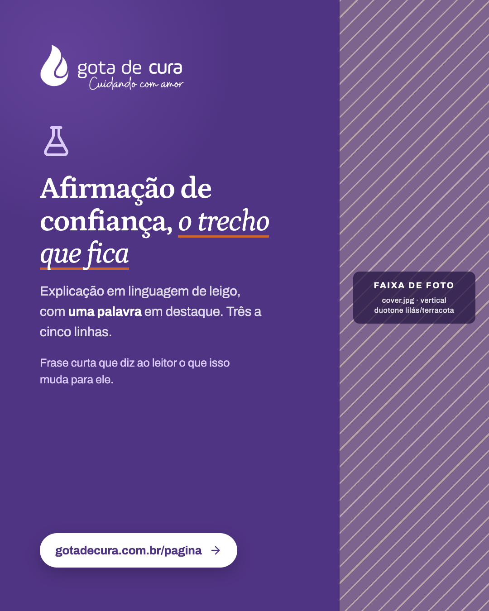
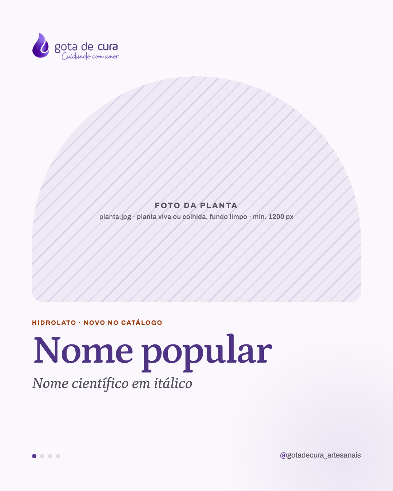
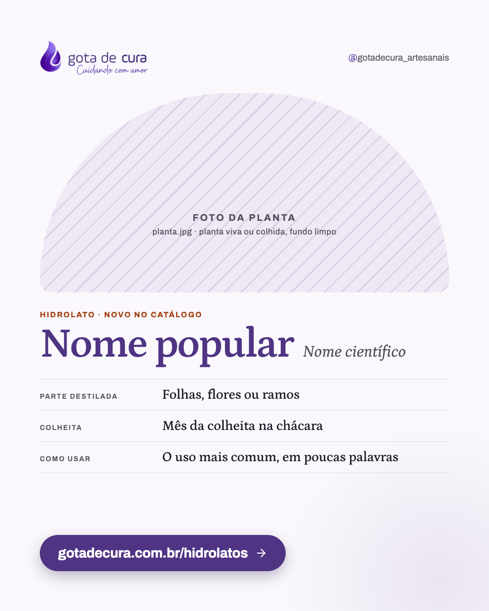
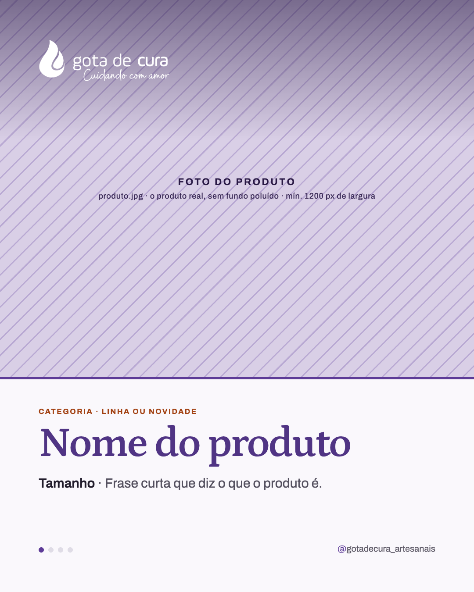
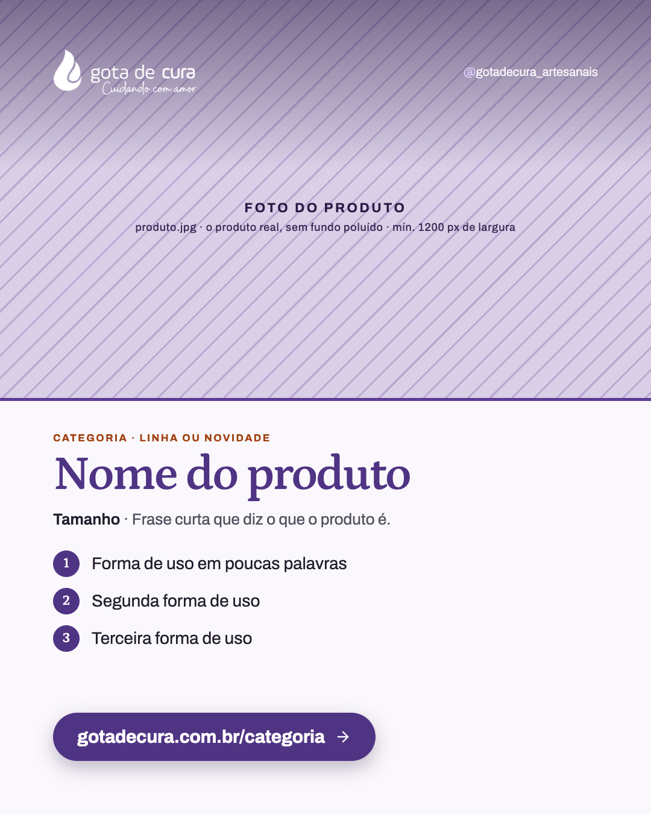
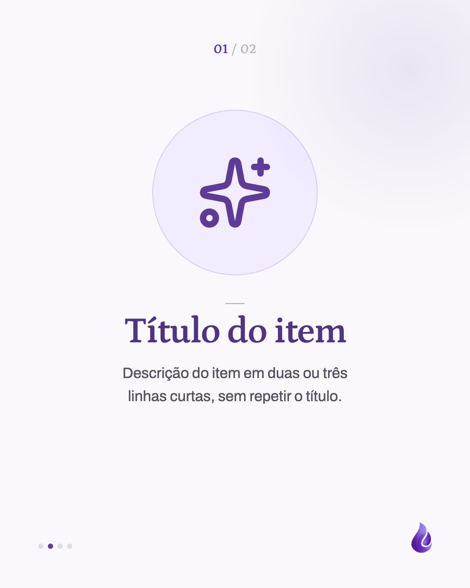
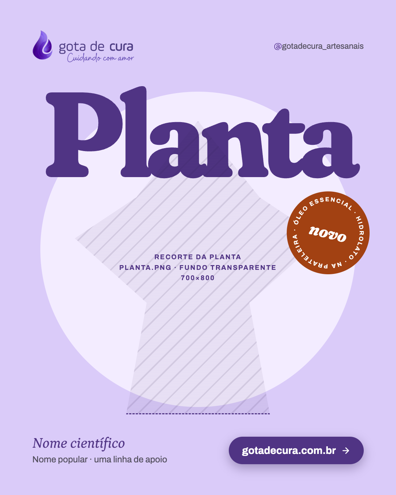
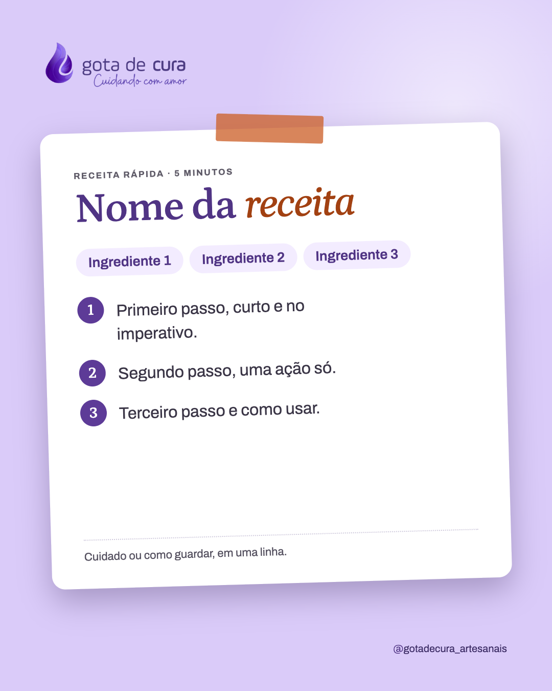

# Templates de post — @gotadecura_artesanais

Esqueletos visuais recorrentes. Ficam entre o `BRAND.md` (paleta, voz, fontes, assinatura:
vale para tudo) e o post concreto (conteúdo e ângulo). A skill `/instagram-post` lê este
índice e **pergunta qual template seguir** antes de desenhar.

```
BRAND.md  →  template escolhido  →  pedido do post
(paleta, voz,   (capa, sequência,     (conteúdo, ângulo,
 assinatura)     papel da imagem)      ajustes pontuais)
```

Cada template tem um `.md` nesta pasta e previews em `previews/<id>/`.

---

## Catálogo

| ID | Nome | Quando usar | Formato | Imagem | Criatividade |
|---|---|---|---|---|---|
| `carrossel-educativo` | [Carrossel educativo](carrossel-educativo.md) | Explicar um conceito em partes (adaptação de post do blog, dúvida frequente). | Carrossel 5–7 | Capa: exige foto | 1 · Base |
| `lista-ilustrada` | [Lista ilustrada](lista-ilustrada.md) | Uma lista de 3 a 5 itens do mesmo tipo (valores, cuidados, motivos), um por slide, cada um com ícone grande, título e descrição. | Carrossel 5–7 | Capa: exige foto; itens: ícone Lucide | 1 · Base |
| `chamada-blog` | [Chamada para o blog](chamada-blog.md) | Anunciar um post novo do blog, com o título do próprio post. | Único | Exige foto | 1 · Base |
| `destaque-faixa` | [Destaque com faixa de foto](destaque-faixa.md) | Uma afirmação de confiança que leva para uma página do site (laudos, sem agrotóxico, água de nascente). | Único | Exige foto (faixa) | 1 · Base |
| `ficha-da-planta` | [Ficha da planta](ficha-da-planta.md) | Lançamento ou apresentação de uma planta do catálogo, com nome popular e científico em destaque. | Carrossel 4–5 **ou** único | Exige foto da planta | 1 · Base |
| `ficha-do-produto` | [Ficha do produto](ficha-do-produto.md) | Apresentar um produto pronto que não é uma planta só (sabonete, pomada, spray, Gotinha), com o que é e como usar. | Carrossel 4–5 **ou** único | Exige foto do produto | 1 · Base |
| `novidade-do-site` | [Novidade do site](novidade-do-site.md) | Anunciar uma mudança no próprio site (idioma novo, página ou função nova), mostrada com 1 a 3 cartões gráficos. | Único | Não usa foto: cartões ilustrados | 2 · Expressivo |
| `bastidores` | [Bastidores da chácara](bastidores.md) | Contar um dia ou um processo da chácara (destilação, colheita, visita), alternando cena e explicação. | Carrossel 4–7 | Exige 2+ fotos | 1 · Base |
| `mito-ou-verdade` | [Mito ou verdade](mito-ou-verdade.md) | Desmentir uma crença comum em uma frase de mito e uma de resposta. | Único | Não usa foto | 2 · Expressivo |
| `receita-rapida` | [Receita rápida](receita-rapida.md) | Um uso prático em até 3 passos, com ingredientes simples e nota de cuidado. | Único | Não usa foto | 2 · Expressivo |
| `janela-em-arco` | [Janela em arco](janela-em-arco.md) | Foto vertical da chácara em arco, com título curto ao lado. | Único | Exige foto vertical | 2 · Expressivo |
| `frase-gigante` | [Frase gigante](frase-gigante.md) | Uma frase curta para ser lida de longe: lema da chácara, afirmação de marca, dado em quatro linhas. | Único | Foto opcional (preenche uma palavra) | 3 · Ousado |
| `recorte-botanico` | [Recorte botânico](recorte-botanico.md) | Apresentar uma planta com o nome gigante atrás do recorte e selo circular. | Único | Exige recorte PNG da planta | 3 · Ousado |
| `colagem-de-gotas` | [Colagem de gotas](colagem-de-gotas.md) | Passo a passo ou sequência numerada, com número gigante e foto em forma de gota. | Carrossel 5–7 | Exige 1 foto por slide (em forma de gota) | 3 · Ousado |
| `rotulo-laudo` | [Rótulo-laudo](rotulo-laudo.md) | Dado do laudo de cromatografia em número gigante, com moldura de etiqueta e régua. | Único ou 2–3 slides | Não usa foto | 3 · Ousado |

---

## Galeria

| `carrossel-educativo` | `chamada-blog` | `destaque-faixa` |
|---|---|---|
|  |  |  |

| `ficha-da-planta` (carrossel) | `ficha-da-planta` (único) | `bastidores` |
|---|---|---|
|  |  |  |

| `ficha-do-produto` (carrossel) | `ficha-do-produto` (único) | `lista-ilustrada` |
|---|---|---|
|  |  |  |

| `novidade-do-site` |
|---|
|  |

| `frase-gigante` | `recorte-botanico` | `rotulo-laudo` |
|---|---|---|
|  |  |  |

| `colagem-de-gotas` (capa) | `colagem-de-gotas` (interno) | `colagem-de-gotas` (fecho) |
|---|---|---|
|  |  |  |

| `mito-ou-verdade` | `receita-rapida` | `janela-em-arco` |
|---|---|---|
|  |  |  |

---

## Sugestão automática

Sinais no pedido que apontam para um template. É só **sugestão**: a skill sempre pergunta.

| Sinal no pedido | Sugestão |
|---|---|
| "carrossel sobre…", "explicar", "diferença entre", "adaptar o post do blog em carrossel" | `carrossel-educativo` |
| "N valores", "N motivos", "N cuidados", "lista", "um por slide", "com ícones" | `lista-ilustrada` |
| "post novo no blog", "chamada para o blog", "divulgar o texto" | `chamada-blog` |
| "cromatografia", "laudo", "sem agrotóxico", "água de nascente", "procedência", link para página do site que não é o blog | `destaque-faixa` |
| nome de planta + "lançamento", "novo no catálogo", "lote", "apresentar o hidrolato de…" | `ficha-da-planta` |
| nome de produto (sabonete, pomada, spray, sais, colônia, tintura, kit, Gotinha) + "lançamento", "conheça", "como usar", "presente" | `ficha-do-produto` |
| "novidade no site", "agora o site tem…", "site em inglês", "página nova", "função nova", "lançamos no site" | `novidade-do-site` |
| "bastidores", "dia de destilação", "colheita", "visita guiada", "como é feito", fotos da chácara | `bastidores` |
| "mito", "verdade", "é verdade que", "será que", crença comum | `mito-ou-verdade` |
| "receita", "como fazer", "passo a passo curto", "cubos de gelo", "spray caseiro", uso do hidrolato em até 3 passos | `receita-rapida` |
| foto vertical da chácara, "convite", "uma manhã na chácara", "planta da estação" com título curto | `janela-em-arco` |
| "frase de impacto", "lema", "manifesto", "frase da chácara", frase curta sem dado | `frase-gigante` |
| nome de planta + "destaque", "chegou", "safra", e há foto recortada | `recorte-botanico` |
| "passo a passo", "5 passos", "etapas da destilação", "do canteiro ao frasco" com fotos soltas | `colagem-de-gotas` |
| "o que o laudo mostra", "percentual", "composto principal", número de cromatografia | `rotulo-laudo` |

**Nível 3 (Ousado)** só aparece quando o cliente aceita criatividade "Ousado" (`BRAND.md`, definição `criatividade`). Nunca mais de 2 a cada 10 posts, e nunca dois seguidos.

Empate comum: **tema educativo sobre uma planta específica**. Se o foco é *o que é e como
usar esta planta*, vá de `ficha-da-planta`; se é *um conceito* que a planta só ilustra, vá
de `carrossel-educativo`.

Outro empate: **lista de itens**. Se todos os itens cabem em título + descrição curta, é
`lista-ilustrada`; se cada um pede um componente diferente (card com dado, colunas,
diagrama), é `carrossel-educativo`.

Outro empate: **produto com uma planta no nome** (ex.: "sabonete de lavanda"). Se o post fala
da planta (origem, destilação, laudo), é `ficha-da-planta`; se fala do produto pronto
(ingredientes, tamanho, como usar), é `ficha-do-produto`.

---

## Previews

- Placeholders descrevem o próprio papel; áreas hachuradas marcam onde entra foto.
- Assets compartilhados (logo e gota) em `previews/_assets/`.
- Exportar: `node scripts/export-templates.mjs [id]` (PNGs em 1×, ao lado de cada HTML).
- Para começar um post, copie o HTML do preview para `html/post-NN/`, troque
  `../_assets/logo.png` por `logo.png` e os placeholders hachurados por ``.

## Gerenciar

- Template novo: `/instagram-post criar-template <ideia>`
- Ajustar um existente: `/instagram-post refinar-template <id> <o que mudar>`
