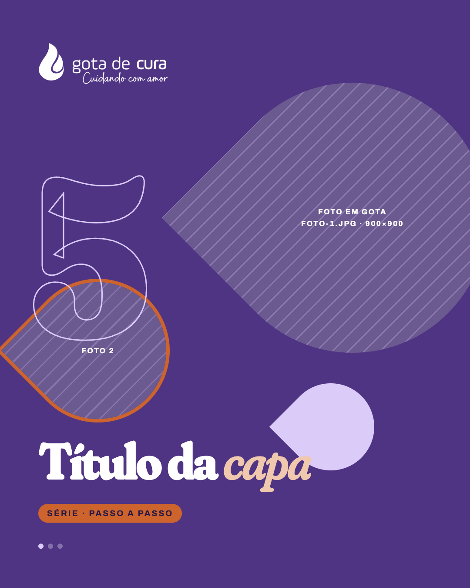
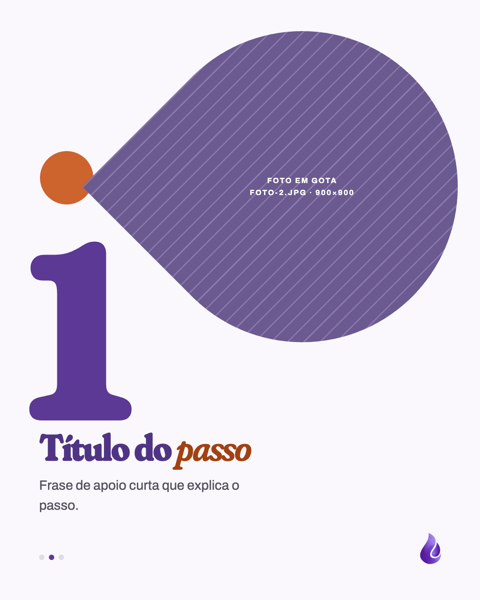

# Template `colagem-de-gotas`

> **Nível de criatividade:** 3 · Ousado. Fonte de exibição própria (Fraunces), números gigantes em contorno ou cheios e fotos recortadas em forma de gota, quebrando a grade.

Carrossel de passo a passo ou bastidores: cada slide tem um **número enorme**, uma foto em forma de gota (a gota da marca) e um título curto. Gotas sólidas e em contorno funcionam como colagem de fundo.

## Preview

| Capa | Interno | Fecho |
|---|---|---|
|  |  |  |

HTML em `previews/colagem-de-gotas/`.

## Quando usar

- Sequência numerada: etapas da destilação, "5 usos do hidrolato", passos de um uso, dia na chácara em momentos.
- Conteúdo que tem boas fotos soltas e pouca explicação por slide.

**Não use quando** os itens são todos do mesmo tipo com ícone: é `lista-ilustrada`. **Não use** para contar um dia com fotos largas e legendas longas: é `bastidores`. Para explicar um conceito sem sequência, é `carrossel-educativo`.

## Estrutura de slides

| Slide | Tema | Papel |
|---|---|---|
| 1 | Escuro `#503484` | Capa: logo, número do total em contorno (ex.: o "5" de "5 usos"), gota com foto, título e selo. |
| 2 a N-1 | Claro `#faf8fc` | Um passo por slide: número gigante cheio, gota com foto, título e apoio. |
| N | Escuro `#291945` | Fecho: logo, frase, URL em texto, apoio e gotas decorativas. |

Total de 5 a 7 slides.

## Capa

```css
.drop { border-radius: 0 50% 50% 50%; transform: rotate(-45deg); overflow: hidden; }   /* gota com a ponta no canto superior esquerdo */
.drop > div { position: absolute; inset: -30%; transform: rotate(45deg); }              /* a foto fica reta dentro */
.num  { font-size: 520px; color: transparent; -webkit-text-stroke: 3px #dacbf9; }
```

Uma gota grande com foto (600px), uma média em contorno terracota com segunda foto (330px) e uma pequena lilás lisa (200px). O número invade a gota média.

## Slides internos

Gota com foto de 700px no alto, número de 520–560px em `#5d3b97` com `mix-blend-mode: multiply` sobre a gota, ponto terracota de 120px e o texto na base. Rule-mark e gota da marca no canto, como nos outros carrosséis.

## Fecho

Fundo `#291945` liso, frase em Fraunces com trecho em itálico `#f0c8ae`, URL em Petrona 60px `#dacbf9` (texto, não botão), gotas lilás `#503484` e em contorno terracota de enfeite.

## Imagens

- **Exige** uma foto por slide interno e 1 ou 2 na capa: `foto-N.jpg`, mínimo 900×900, assunto no centro (a gota corta os cantos).
- Logo de `assets/logos/logo.png` (branco por filtro) na capa e no fecho; `mark.png` nos internos.

## Tipografia própria

Exceção ao `BRAND.md`: os títulos de destaque deste template usam **Fraunces** (Google Fonts), em vez do Petrona. O resto (apoio, rótulos, nome científico, URL do fecho) segue o `BRAND.md`.

```html
<link href="https://fonts.googleapis.com/css2?family=Fraunces:ital,opsz,wght,SOFT,WONK@0,9..144,300..900,0..100,0..1;1,9..144,300..900,0..100,0..1&family=Petrona:ital,wght@0,400;0,500;0,600;0,700;1,400&family=Archivo:wght@400;500;600;700&display=swap" rel="stylesheet">
```

```css
.display { font-family: 'Fraunces', serif; font-variation-settings: 'SOFT' 100, 'WONK' 1, 'opsz' 144;
  font-weight: 800; letter-spacing: -0.04em; line-height: 0.94; }
```

## Escala tipográfica

| Elemento | Tamanho |
|---|---|
| Número | 520–560px Fraunces 800 |
| Título da capa | 118px Fraunces 800 |
| Título interno | 84px Fraunces 800 |
| Apoio interno | 30px Archivo |
| Título do fecho | 120px Fraunces 800 |
| URL do fecho | 60px Petrona 600 |

## Variações permitidas

- Número em contorno (capa) ou cheio (internos), ou ao contrário em um slide.
- Posição da gota principal (direita, esquerda) e tamanho entre 560 e 760px.
- Ponta da gota apontando para qualquer canto (rotação), sem repetir em slides vizinhos.
- Cor do ponto/gota de apoio: terracota, lilás suave ou marca clara.
- Quantidade de slides: 5 a 7.
- Fecho com ou sem a nota da Morada.

## Travas

- **Foto sempre dentro da gota da marca** (`border-radius: 0 50% 50% 50%`). É o que une as fotos num feed só.
- **Um número e um passo por slide.** Número sem passo vira decoração.
- **Número com no máximo 2 dígitos** e sempre a mesma sequência crescente.
- **Fraunces só em números e títulos.** Apoio em Archivo, URL em Petrona.
- **Slides internos claros, capa e fecho escuros**, com `background` no `body`.
- Terracota só em detalhes (ponto, contorno, selo), nunca como fundo.
- Herdadas do `BRAND.md`: marcador de círculos em todos os slides, logo só na capa e no fecho, gota (`mark.png`) nos internos, nada de emoji, no máximo 1 travessão por slide.

## Posts de referência

Nenhum ainda.
