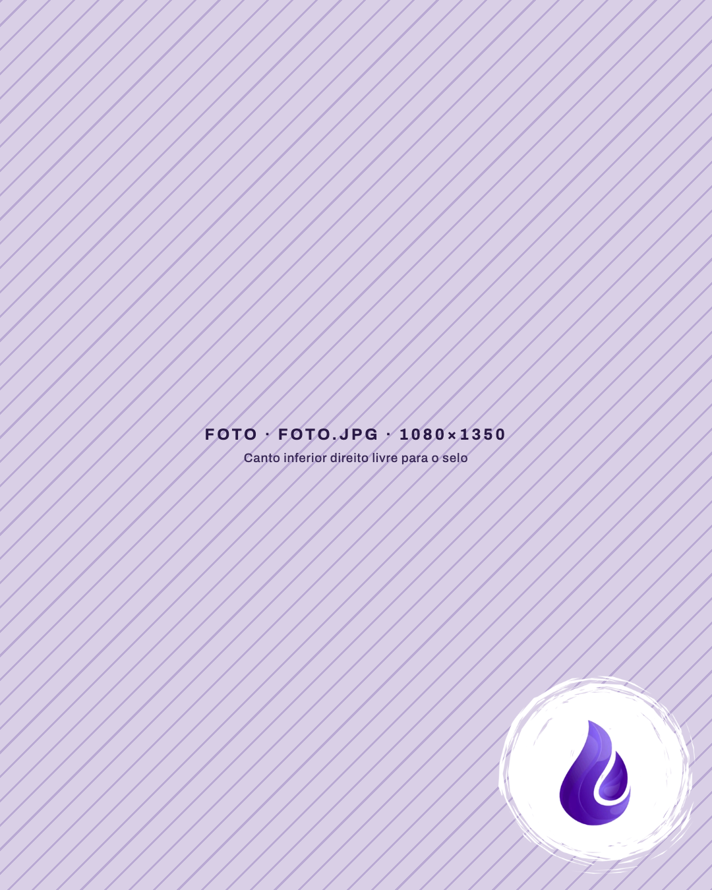
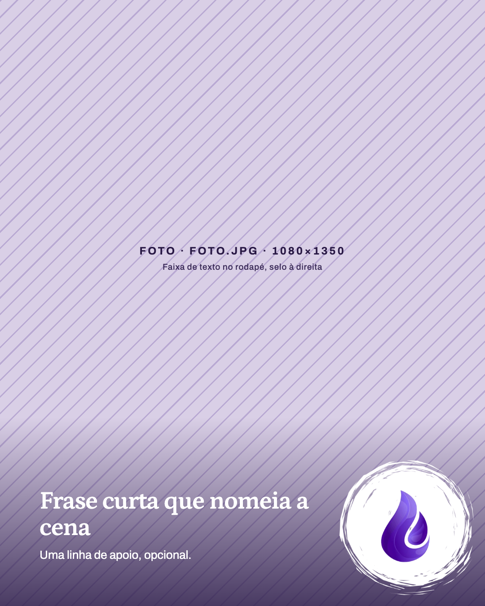

# Template `foto-selo`

> **Nível de criatividade:** 1 · Base. Só as fontes da marca e uma composição previsível, sem efeito de texto ou de imagem.

A foto é o post: ela ocupa o slide inteiro e o único elemento fixo é o selo da gota no canto
inferior direito. Slide único, sem texto por padrão; uma faixa curta no rodapé é opcional.

## Preview

| Só foto e selo | Com faixa de texto |
|---|---|
|  |  |

HTML em `previews/foto-selo/`.

## Quando usar

- Uma foto forte que se explica sozinha: a Gotinha com os produtos, a banca na feira, um canteiro
  florido, um momento da visita.
- Pilar **Produto** ou **Bastidores da chácara** quando a imagem pesa mais que o texto.
- A informação ("onde", "quando", "o que é") cabe na legenda do post.

**Não use quando** a foto precisa de explicação em slides ou de dados (preço, tamanho, como
usar): é `ficha-do-produto` ou `ficha-da-planta`. **Não use** para contar um processo em
sequência: é `bastidores`. Para foto em arco com título ao lado, é `janela-em-arco`.

## Estrutura de slides

Slide único, 1080×1350, tema da própria foto. Camadas, de baixo para cima: foto sangrada,
scrim e faixa (opcionais), selo.

## Capa

```css
body, .slide { background: #503484; }  /* body declarado, por segurança */
.photo { position: absolute; inset: 0; width: 1080px; height: 1350px; object-fit: cover; }
.selo  { position: absolute; right: 24px; bottom: 24px; width: 300px; height: auto; }
/*  */
```

Variação com faixa de texto:

```css
.scrim { position: absolute; left: 0; right: 0; bottom: 0; height: 420px;
  background: linear-gradient(0deg, rgba(41,25,69,0.82) 0%, rgba(41,25,69,0) 100%); }
.faixa { position: absolute; left: 88px; bottom: 96px; width: 600px; }  /* nunca invade o selo */
.faixa h1 { font-family: 'Petrona', serif; font-weight: 600; font-size: 56px; line-height: 1.05;
  letter-spacing: -0.02em; color: #ffffff; }
.faixa p { font-size: 26px; line-height: 1.4; color: #ffffff; margin-top: 12px; }
```

## Slides internos

Não tem.

## Fecho

Não tem. O selo faz o papel de assinatura; o handle e o CTA vão na legenda.

## Imagens

- **Exige** 1 foto, vertical (4:5), nome `foto.jpg` na pasta do post, 1080×1350 no mínimo.
- Passa pela edição básica de luz, contraste e cor (`melhorar-foto.py`) antes de entrar.
- Enquadre deixando o **canto inferior direito livre** de rótulo, texto ou rosto: o selo ocupa
  uns 300×300 px ali. Como a gota é roxa e não tem fundo, o canto precisa ser claro e calmo (mesa,
  parede, céu); em canto escuro ou cheio de detalhe a gota some.
- Com faixa de texto, o rodapé esquerdo também precisa ser calmo (mesa, céu, folhagem).

## Escala tipográfica

Só na variação com faixa: título `Petrona` 600, 56 px (48 a 64 conforme o tamanho da frase);
apoio `Archivo` 26 px. Sem faixa não há texto no slide.

## Variações permitidas

- Com ou sem faixa de texto.
- Tamanho do título da faixa (48 a 64 px) e uma frase de apoio opcional.
- Foto de produto, de cena, de pessoas ou de paisagem.
- Tamanho do selo: 260 a 340 px, mantendo o canto.
- Intensidade do scrim (0,6 a 0,85), só com faixa.
- Foto horizontal recortada em 4:5 com o assunto à esquerda ou ao centro.

## Travas

- **Selo fixo no canto inferior direito**, de `assets/logos/selo-gota.png`, sempre por cima de
  tudo. É a assinatura do formato: o feed reconhece o post antes de ler.
- **A foto ocupa o slide inteiro**, sem moldura, cantos arredondados ou painel. É o que separa
  este template dos de ficha.
- **No máximo um título e uma linha de apoio**, só no rodapé esquerdo e nunca sobre o selo. Mais
  texto que isso vira outro template (e vai para a legenda).
- **Nada de emoji, filtro colorido ou efeito na foto.** A edição só corrige luz e cor; a
  fotografia da chácara carrega a identidade.
- Texto branco só sobre scrim `#291945` (contraste AA). Fundo do `body` declarado.
- **Sem círculo ou moldura atrás do selo**: é só a gota, com o PNG transparente.
- Não repita o logo completo no slide: o selo já é a marca.

## Posts de referência

Nenhum ainda. Origem do formato: arte de fotos da Gotinha com sabonete, spray e creme (selo no
canto inferior direito).
