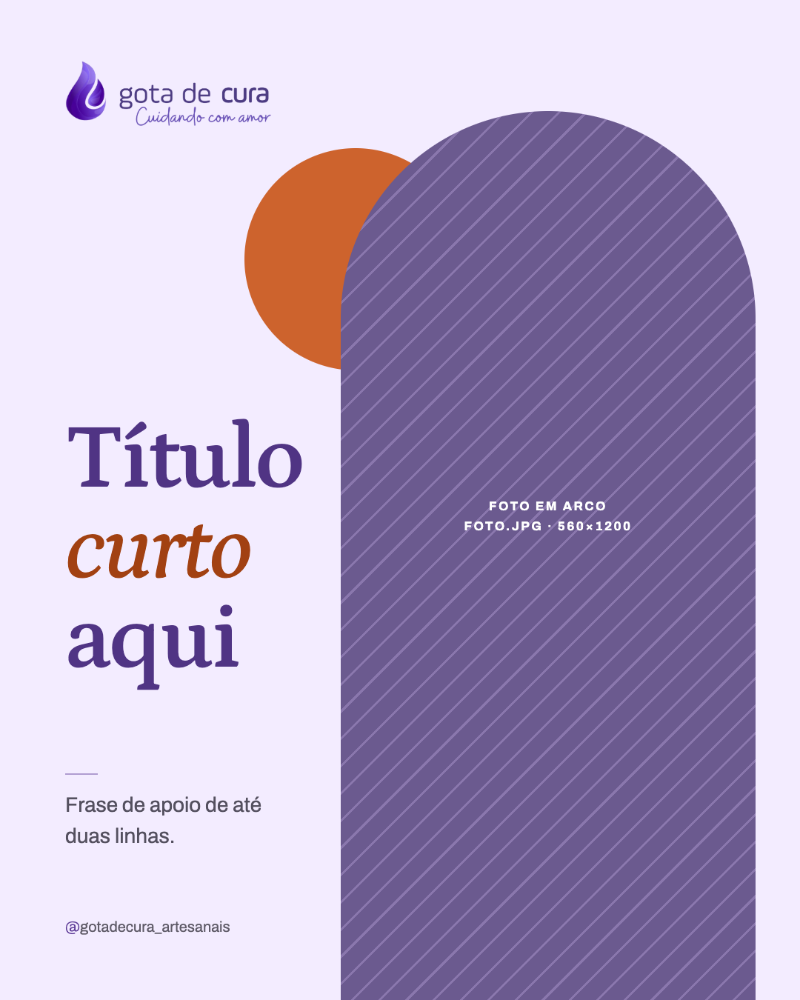

# Template `janela-em-arco`

> **Nível de criatividade:** 2 · Expressivo. Mesmas fontes da marca; foto em arco que sangra pela base e círculo terracota atrás, fora da grade habitual.

Slide único com uma **foto vertical recortada em arco** (como uma janela da chácara), título grande ao lado e um círculo terracota que aparece por trás do arco.

## Preview

| Único |
|---|
|  |

HTML em `previews/janela-em-arco/`.

## Quando usar

- Foto vertical forte da chácara, de uma planta ou de uma cena de visita, com título curto: convite para a visita, "uma manhã na chácara", planta da estação.
- Post de respiro entre posts mais densos do feed.

**Não use quando** a foto é horizontal ou o assunto está na área inteira da imagem: é `chamada-blog` ou `destaque-faixa`. **Não use** para planta do catálogo com ficha: é `ficha-da-planta`. **Não use** sem foto vertical de qualidade.

## Estrutura de slides

| Slide | Tema | Papel |
|---|---|---|
| 1 | Claro `#f3ecff` | Logo, círculo terracota, foto em arco à direita, título à esquerda, apoio e handle. |

## Capa

```css
.arch { position: absolute; right: 60px; top: 150px; width: 560px; height: 1300px; border-radius: 280px 280px 0 0; overflow: hidden; } /* sangra pela base */
.arch img { width: 100%; height: 100%; object-fit: cover; }
.sun  { width: 300px; height: 300px; border-radius: 50%; background: #cd632d; left: 330px; top: 200px; } /* atrás do arco */
h1 { font-size: 124px; line-height: 0.98; max-width: 6ch; } h1 em { color: #a24112; font-style: italic; }
```

## Slides internos

Não tem.

## Fecho

Não tem. Handle à esquerda no rodapé; CTA na legenda.

## Imagens

- **Exige** `foto.jpg` vertical, mínimo 1120×2400 recorte, assunto na metade de cima (a base pode ser cortada).
- `alt` descritivo. Logo de `assets/logos/logo.png` sem filtro.

## Escala tipográfica

| Elemento | Tamanho |
|---|---|
| Título | 124px Petrona 600, 3 linhas de até 6 letras por palavra |
| Apoio | 28px Archivo, até 2 linhas, largura 320px |

## Variações permitidas

- Arco à direita (padrão) ou à esquerda, com o texto do outro lado.
- Fundo `#f3ecff`, `#faf8fc` ou `#f1eef6`.
- Círculo terracota `#cd632d` ou lilás claro `#dacbf9`, acima ou abaixo do arco.
- Largura do arco entre 520 e 600px.
- Palavra em itálico terracota no título (uma só).
- Apoio presente ou ausente.

## Travas

- **Arco com a base sangrando pela borda inferior e o topo arredondado.** É a assinatura do formato.
- **Texto nunca sobre a foto.** O título fica no fundo claro, ao lado do arco, para manter contraste AA.
- **Círculo terracota pequeno (até 300px) e parcialmente escondido pelo arco.** Terracota nunca vira fundo grande.
- **Foto sempre da chácara real**, nunca de banco de imagens genérico quando o assunto é a chácara.
- Herdadas do `BRAND.md`: logo no topo, sem marcador de carrossel, nada de emoji, no máximo 1 travessão.

## Posts de referência

Nenhum ainda.
