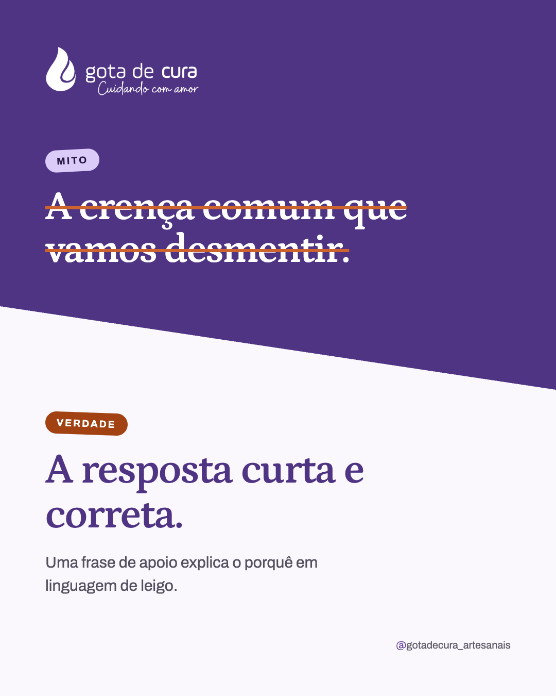

# Template `mito-ou-verdade`

> **Nível de criatividade:** 2 · Expressivo. Mesmas fontes da marca, mas com corte diagonal na composição, texto riscado e selos levemente girados.

Slide único dividido na diagonal: em cima, em lilás escuro, o **mito** com o texto riscado; embaixo, em claro, a **verdade** em frase curta com uma linha de apoio.

## Preview

| Único |
|---|
|  |

HTML em `previews/mito-ou-verdade/`.

## Quando usar

- Desmentir uma crença comum sobre óleo essencial, hidrolato ou aromaterapia ("hidrolato é só água com cheiro", "óleo essencial puro pode ir direto na pele").
- Dúvida que cabe em uma frase de mito e uma de resposta.

**Não use quando** a resposta precisa de passos ou dados: é `carrossel-educativo`. **Não use** para promessa terapêutica: a "verdade" nunca afirma cura (regra do `BRAND.md`). Para o assunto vir de um post do blog, `chamada-blog`.

## Estrutura de slides

| Slide | Tema | Papel |
|---|---|---|
| 1 | Escuro `#503484` em cima, claro `#faf8fc` embaixo | Logo, selo "Mito" + frase riscada, selo "Verdade" + resposta e apoio. |

## Capa

```css
.top { background: #503484; clip-path: polygon(0 0, 100% 0, 100% 56%, 0 44%); }
.mito p { color: #fff; text-decoration: line-through; text-decoration-color: #cd632d; text-decoration-thickness: 6px; }
.tag { transform: rotate(-3deg); }            /* selo "Mito" em #dacbf9; "Verdade" em #a24112, girado +2° */
.verdade p { color: #503484; font-size: 70–82px; }
```

## Slides internos

Não tem.

## Fecho

Não tem. Handle no rodapé à direita; CTA na legenda.

## Imagens

Não usa foto. Logo de `assets/logos/logo.png`, branco por filtro (fica sobre a parte escura).

## Escala tipográfica

| Elemento | Tamanho |
|---|---|
| Mito (riscado) | 78px Petrona 600 |
| Verdade | 70–82px Petrona 600, até 2 linhas |
| Apoio | 28–30px Archivo |
| Selos | 19px, caixa alta |

## Variações permitidas

- Inclinação do corte: de 44%/56% a 38%/62%.
- Cor do risco: terracota clara `#cd632d` ou `#f0c8ae`.
- Inversão: "Verdade" em cima e "Mito" embaixo (só quando o mito é a surpresa).
- Trecho em itálico terracota `#a24112` dentro da frase da verdade.
- Apoio presente ou ausente.
- Selos: "Mito/Verdade" ou "Muita gente acha/Na prática".

## Travas

- **Mito sempre riscado, verdade sempre sem risco.** A leitura rápida depende desse contraste.
- **O mito é escrito como as pessoas dizem**, em frase curta; nunca atribuído a alguém ou a uma marca.
- **A verdade não promete efeito terapêutico** e, se o tema pedir, traz o cuidado de segurança no apoio.
- **Corte diagonal em todos os posts do formato.** É o que o separa do `destaque-faixa`.
- Herdadas do `BRAND.md`: logo no topo, `background` no `body`, sem marcador de carrossel, nada de emoji, no máximo 1 travessão.

## Posts de referência

Nenhum ainda.
