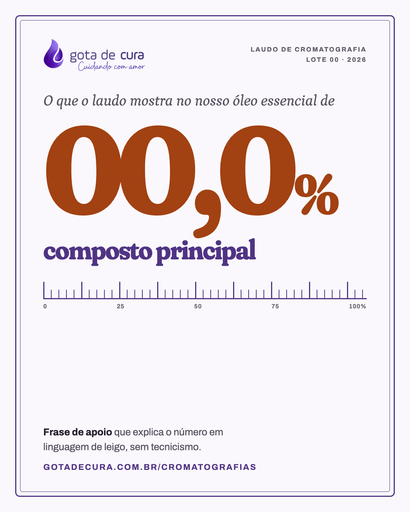
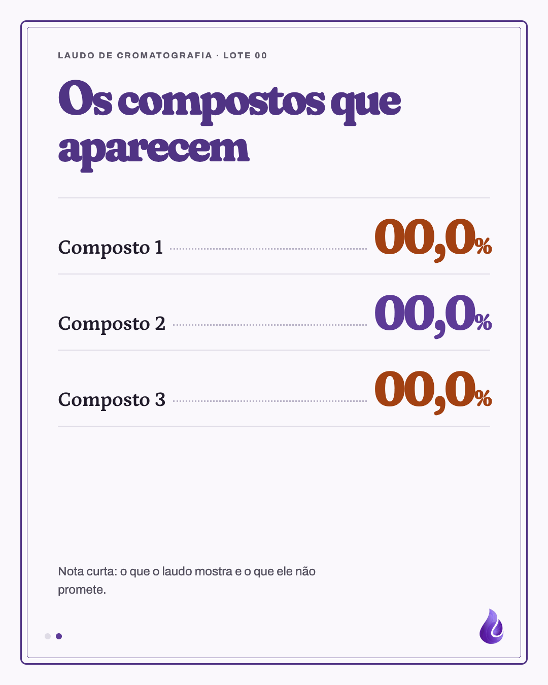

# Template `rotulo-laudo`

> **Nível de criatividade:** 3 · Ousado. Fonte de exibição própria (Fraunces) com dado em tamanho gigante, moldura dupla de etiqueta e régua de medição.

Post de confiança com estética de etiqueta de frasco ampliada: moldura dupla lilás, um percentual do laudo em Fraunces enorme, régua graduada e linhas com pontilhado. Um slide, ou três quando o laudo tem mais compostos.

## Preview

| Dado (1) | Compostos (2) |
|---|---|
|  |  |

HTML em `previews/rotulo-laudo/`.

## Quando usar

- Mostrar o que a cromatografia de um lote revela: o composto principal em número grande e os seguintes em lista.
- Reforçar o diferencial de confiança (laudos publicados) de forma mais visual que o `destaque-faixa`.

**Não use quando** o assunto é confiança sem dado numérico (sem agrotóxico, água de nascente): é `destaque-faixa`. **Não use** para ensinar a ler um laudo passo a passo: é `carrossel-educativo`. **Nunca** use números inventados: todo valor vem do laudo publicado em `/cromatografias`.

## Estrutura de slides

| Slide | Tema | Papel |
|---|---|---|
| 1 | Claro `#faf8fc`, moldura lilás | Dado: logo, lote, frase de abertura, percentual gigante, nome do composto, régua, apoio e URL. |
| 2 (opcional) | Claro | Lista de até 3 compostos com pontilhado e percentual. |
| 3 (opcional) | Escuro `#291945` | Fecho: logo, frase, `gotadecura.com.br/cromatografias`. |

Post único (só o slide 1) ou carrossel de 2 a 3 slides.

## Capa

```css
.frame { position: absolute; inset: 40px; border: 3px solid #503484; border-radius: 12px; }
.frame::after { content: ''; position: absolute; inset: 10px; border: 1px solid #503484; border-radius: 6px; }
.big { font-size: 330px; color: #a24112; letter-spacing: -0.06em; }  .big small { font-size: 150px; }
.ruler { height: 46px; border-bottom: 3px solid #503484;
  background: repeating-linear-gradient(90deg, #503484 0 2px, transparent 2px 20px) bottom / 100% 22px no-repeat,
              repeating-linear-gradient(90deg, #503484 0 3px, transparent 3px 100px) bottom / 100% 44px no-repeat; }
```

A régua vai de 0 a 100%. Em um post de mais de um slide, um marcador (barra terracota de 3px) pode indicar a posição do valor na régua.

## Slides internos

Linhas `.row`: nome do composto em Petrona 40px, pontilhado `dotted #b9b3c7` e valor em Fraunces 96px, terracota (padrão) e lilás `#5d3b97` em contraponto. Máximo de 3 linhas.

## Fecho

Quando houver, fundo `#291945`, logo 270px branco, frase com trecho em itálico e a URL em Petrona 60px `#dacbf9`.

## Imagens

- **Não usa foto.** O dado é a imagem.
- Logo de `assets/logos/logo.png` sem filtro (slides claros) e `mark.png` nos internos.

## Tipografia própria

Exceção ao `BRAND.md`: os títulos de destaque deste template usam **Fraunces** (Google Fonts), em vez do Petrona. O resto (apoio, rótulos, nome científico, URL do fecho) segue o `BRAND.md`.

```html
<link href="https://fonts.googleapis.com/css2?family=Fraunces:ital,opsz,wght,SOFT,WONK@0,9..144,300..900,0..100,0..1;1,9..144,300..900,0..100,0..1&family=Petrona:ital,wght@0,400;0,500;0,600;0,700;1,400&family=Archivo:wght@400;500;600;700&display=swap" rel="stylesheet">
```

```css
.display { font-family: 'Fraunces', serif; font-variation-settings: 'SOFT' 100, 'WONK' 1, 'opsz' 144;
  font-weight: 800; letter-spacing: -0.04em; line-height: 0.94; }
```

## Escala tipográfica

| Elemento | Tamanho |
|---|---|
| Percentual gigante | 330px Fraunces 800 (símbolo % em 150px) |
| Nome do composto | 74px Fraunces 700 |
| Frase de abertura | 40px Petrona itálico |
| Valor nas linhas | 96px Fraunces 800 |
| Nome nas linhas | 40px Petrona 600 |
| Apoio | 24–26px Archivo |

## Variações permitidas

- Cor do percentual: terracota `#a24112` (padrão) ou lilás `#5d3b97`.
- Moldura: lilás `#503484` (padrão) ou terracota `#a24112`.
- Régua com marcador do valor ou sem.
- Frase de abertura: "O que o laudo mostra no nosso óleo essencial de [planta]" ou outra de uma linha.
- 1 slide, 2 slides (dado + compostos) ou 3 (com fecho).
- Fundo claro `#faf8fc` ou `#f1eef6`.

## Travas

- **Todo número vem do laudo publicado**, com lote e ano na etiqueta. Se o número não está no site, não entra no post.
- **Dado numérico sempre acompanhado de frase em linguagem de leigo.** Ciência sem intimidar (regra de marca).
- **Sem promessa terapêutica:** o laudo mostra composição, não efeito.
- **Moldura dupla e régua em todos os slides do post.** É o que faz o formato ser reconhecido como "laudo".
- **Fraunces só no percentual, nos valores e no nome do composto.**
- Máximo de 3 compostos por slide.
- Herdadas do `BRAND.md`: marcador de círculos quando houver mais de um slide, gota nos internos, `background` no `body` dos escuros, nada de emoji.

## Posts de referência

Nenhum ainda. Dados de exemplo: laudo da melaleuca no post-11.
